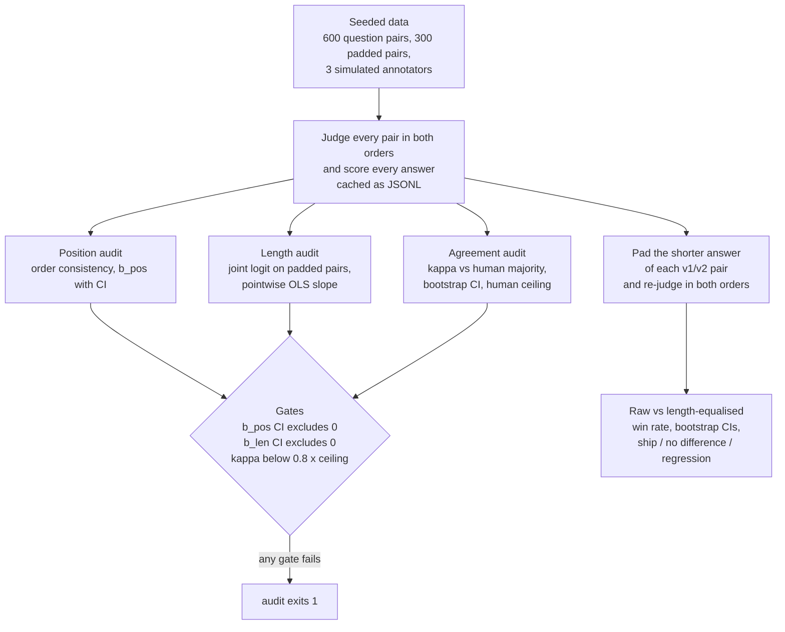

# judgeaudit

[](https://github.com/SlateGitOrg/judgeaudit/actions/workflows/ci.yml)


judgeaudit audits an LLM-as-judge before its win rate is allowed to decide a release. It estimates
the judge's position bias and length bias on matched pairs whose quality is identical by
construction, measures its agreement with human labels against the human-human ceiling, applies
three pass/fail gates, and then recomputes the release decision with answer lengths equalised. The
CLI exits non-zero when a gate fails, so it can run in CI. All data in this repository is
synthetic, and the audit is validated against a simulated judge with planted biases of known size.

## The problem

An online retailer's ML team chooses between two versions of its product-question answering bot by
their pairwise LLM-judge win rate. LLM judges favour the answer shown first and the longer answer.
When the new version is just wordier, a 58% win rate ships a change that is no better. Nobody
audits the judge, so a result that looks like a win can be noise plus bias.

## How it works



Three kinds of pairs are judged, each in both presentation orders:

- **v1 against v2** (600 questions): the pairs the release decision is made on.
- **Padded pairs** (300): an answer against a copy of itself padded with neutral filler sentences
  to 1.4 to 2.6 times its length. Latent quality is identical, so any preference is position or
  length.
- **Equalised pairs** (600): each v1/v2 pair with the shorter answer padded to the longer one's
  length, used only for the release comparison.

The audits:

- `audits/position.py` reports the order-consistency rate (how often the same answer wins in both
  orders) and b_pos with a 95% CI and a test of b_pos = 0.
- `audits/length.py` fits one logistic regression, P(first wins) ~ b_pos + b_len x (ln len_first -
  ln len_second), on the padded pairs and reports both coefficients with 95% CIs. It also fits an
  OLS slope of the 1-5 pointwise score on ln length.
- `audits/agreement.py` computes Cohen's kappa (unweighted for pairwise verdicts, quadratic-weighted
  for 1-5 scores). The judge-versus-human-majority kappa gets a percentile bootstrap CI (2,000
  resamples over pairs), and the mean pairwise human-human kappa is the ceiling.
- `compare.py` computes v2's win rate averaged over both orders, raw and length-equalised, each with
  a pair-bootstrap CI. If the equalised CI is above 0.5 the decision is "ship", if it contains 0.5
  it is "no significant difference", and if it is below 0.5 it is "regression".

## Quick start

```bash
uv venv .venv                           # any Python 3.11+
uv pip install --python .venv/bin/python -e ".[dev]"

.venv/bin/judgeaudit seed                                  # writes data/dataset.json
.venv/bin/judgeaudit run --judge judges/biased.yaml        # judge both orders, cache verdicts
.venv/bin/judgeaudit audit --judge judges/biased.yaml      # Markdown audit; exit 1 on a failed gate
.venv/bin/judgeaudit audit --judge judges/clean.yaml       # exit 0
.venv/bin/judgeaudit compare --judge judges/biased.yaml    # raw vs length-equalised win rate

.venv/bin/judgeaudit seed --v2-better 0.3 --out data/better.json   # v2 really is better
.venv/bin/judgeaudit compare --judge judges/biased.yaml --data data/better.json
```

To audit a real model, point an OpenAI-compatible endpoint at `judges/live.yaml`:

```bash
export JUDGEAUDIT_LLM_BASE_URL=https://api.example.com/v1
export JUDGEAUDIT_LLM_API_KEY=...
export JUDGEAUDIT_LLM_MODEL=my-judge-model
.venv/bin/judgeaudit audit --judge judges/live.yaml
```

The prompt asks for "A" or "B", which map to the first and second answer. Verdicts are cached, so
an interrupted run resumes where it stopped. A live judge is called 4,800 times on the default
data: 3,000 pairwise verdicts (1,500 pairs in two orders) and 1,800 pointwise scores.

## Example output

`judgeaudit seed`:

```text
wrote data/dataset.json
600 questions in 8 categories, 300 padded pairs
v2 is 2.03x as long as v1; v2 quality shift +0.00
mean pairwise human-human kappa 0.649
```

`judgeaudit audit --judge judges/biased.yaml` (exit code 1). The planted values are b_pos = 0.6 and
b_len = 1.2; both are inside their intervals:

```text
# Judge audit: biased

Judge config `fbe1ad6005d034d6`. Data: 600 questions judged in both orders, 300 padded pairs (synthetic).

**Result: FAIL (2 of 3 gates)**

| Gate | Criterion | Estimate (95% CI) | Result |
| --- | --- | --- | --- |
| Position bias | 95% CI of b_pos excludes 0 | +0.717 [+0.532, +0.903] | FAIL |
| Length bias | 95% CI of b_len excludes 0 | +1.187 [+0.923, +1.451] | FAIL |
| Agreement with humans | kappa >= 0.8 x human ceiling (0.519) | 0.602 [0.550, 0.648] | pass |

## Position

- b_pos: +0.717 [+0.532, +0.903], p = 3.3e-14 (positive favours the answer shown first)
- Order consistency on v1/v2 pairs: 76.2% (600 pairs)
- Order consistency on padded pairs: 52.3% (300 pairs; 50% is expected if each order's verdict is an independent fair coin flip: equal quality, no preference for either answer, no position preference)

## Length

- b_len: +1.187 [+0.923, +1.451], p = 1.1e-18 (log-odds of winning per unit of ln length ratio)
- At twice the length, the longer answer wins 67.5% of the time with quality equal and the order averaged
- Pointwise length slope: +0.574 [+0.438, +0.710] score points per unit of ln length

## Agreement

- Judge vs human majority, pairwise kappa: 0.602 [0.550, 0.648]
- Mean pairwise human-human kappa (ceiling): 0.649; gate threshold 0.519
- Pointwise scores vs annotator panel, quadratic-weighted kappa: 0.576 [0.534, 0.611]
```

The same audit for `judges/clean.yaml` (exit code 0) gives b_pos -0.027 [-0.182, +0.129], b_len
-0.138 [-0.376, +0.099] and kappa 0.642 [0.590, 0.688], so all three gates pass.

Release comparison on the default data, where v2 is no better than v1 but about twice as long.
The biased judge reports a win that disappears once lengths are equalised:

| Judge | Raw v2 win rate | Length-equalised v2 win rate | Decision |
| --- | --- | --- | --- |
| biased | 0.593 [0.558, 0.626] | 0.503 [0.469, 0.541] | no significant difference |
| clean | 0.502 [0.468, 0.538] | 0.499 [0.465, 0.537] | no significant difference |

Power check with `seed --v2-better 0.3`, where v2 really is better. The biased judge still ships it
after equalising, and its raw number overstates the gain:

| Judge | Raw v2 win rate | Length-equalised v2 win rate | Decision |
| --- | --- | --- | --- |
| biased | 0.719 [0.689, 0.748] | 0.619 [0.586, 0.654] | ship |

## Design decisions

- **Length bias is measured on padded copies, not on v1/v2 pairs.** On real pairs a longer answer
  is often a better one, so regressing the verdict on length mixes bias with quality. A padded pair
  has the same content on both sides by construction, so the coefficient is length alone. The cost
  is that the filler has to be neutral: a real judge might react to the filler's tone or to
  repetition, and that effect is folded into b_len. The audit measures what padding does to this
  judge, which is also what the equalised comparison does to it.
- **Position bias comes from the same fit as length bias.** Each padded pair is judged in both
  orders, so the intercept of the logit is the preference for the first slot with the length
  difference held fixed. Standard errors are clustered by pair, because the two verdicts for a pair
  are not independent for a real judge. The price is that the position estimate has the same
  300-pair sample as the length estimate.
- **Gates test whether an interval excludes zero, not whether an effect exceeds a size.** This is
  simple and has a known false-alarm rate (checked over 100 replicates in the tests), but a large
  sample will flag a tiny bias and a small one will miss a moderate bias. The report prints the
  effect in plain terms (the longer answer wins 67.5% of the time at twice the length) so a reader
  can judge whether a flagged bias matters.
- **Kappa is pooled over both orders and gated relative to the humans.** Each pair contributes its
  verdict in both orders against one human majority label, so a judge that flips with position
  loses agreement. The gate is 0.8 times the mean human-human kappa instead of an absolute number,
  because the achievable agreement depends on how noisy the humans are. A judge can still pass this
  gate while being biased, which is why the position and length gates exist.
- **The release decision is recomputed on equalised lengths.** The shorter answer is padded to the
  longer one's length, so the pair differs only in quality. This answers "would v2 still win if it
  were not wordier" and, like the bias audits, relies on the padding being neutral. The decision
  uses the equalised interval only, so a lucky raw win rate cannot trigger "ship".
- **Verdicts are cached under a fingerprint of the inputs.** The key is (judge config hash, pair
  id, order), and an entry is reused only when a hash of the question, answer texts and latent
  qualities still matches. Regenerating the dataset with the same pair ids therefore re-judges it,
  at the cost of one extra hash per call.

## Testing

```bash
.venv/bin/python -m pytest -q
uvx ruff check . && uvx ruff format --check .
JUDGEAUDIT_LIVE=1 .venv/bin/python -m pytest -q -m live   # optional, needs the three env vars
```

The suite runs offline and checks behaviour against known answers:

- Cohen's kappa for the confusion table [[20, 5], [10, 15]] is 0.40, and quadratic-weighted kappa
  matches a hand-computed 3x3 example.
- The same judge config and seed give byte-identical verdict files; a changed seed, config or rubric
  gives different or separate cache entries.
- The biased judge's b_pos and b_len intervals contain 0.6 and 1.2 and exclude 0; other planted
  sizes are also recovered.
- The clean judge passes all three gates, and across 100 replicate datasets the position gate fires
  in at most 11 (nominal rate 5%).
- On the default data the biased judge's raw win rate is above 0.55 with a CI that excludes 0.5,
  its equalised CI contains 0.5, and the decision is "no significant difference". With
  `--v2-better 0.3` the equalised CI is above 0.5 and the decision is "ship".
- `audit` exits 1 for the biased judge and 0 for the clean one. The live-judge test is skipped
  unless `JUDGEAUDIT_LIVE=1`; the HTTP adapter is tested against a mock transport.

## Project layout

```text
judges/                 biased.yaml, clean.yaml (simulated), live.yaml (OpenAI-compatible)
src/judgeaudit/
  cli.py                seed, run, audit, compare
  data.py, textbank.py  seeded generator, filler bank and padding
  models.py             Answer, Question, PaddedPair, EqualisedPair, Dataset
  judge.py              Judge protocol, SimulatedJudge, OpenAICompatJudge, config loading
  runner.py             both-order judging and the JSONL verdict cache
  audits/               position.py, length.py, agreement.py, _fit.py (shared logit)
  compare.py            raw and length-equalised release comparison
  report.py             gates and Markdown rendering
  stats.py              Cohen's kappa and the percentile bootstrap
  seeding.py            stable hash-seeded random streams
tests/                  unit, recovery, false-alarm and CLI tests
```

## License

MIT. See `LICENSE`.
